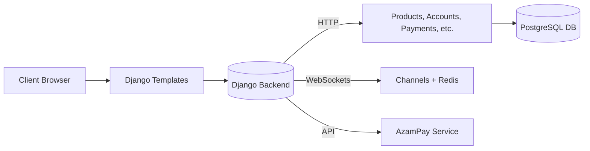

# Mkulima App

**Mkulima App** is a full-stack Django application that connects farmers and buyers in a streamlined marketplace. It provides product listings, real-time chat, secure payments, and subscription management — all designed to help farmers reach a wider audience and buyers find the best deals.

## Table of Contents

- [Features](#features)  
- [Tech Stack](#tech-stack)  
- [Architecture Overview](#architecture-overview)  
- [Installation](#installation)  
- [Usage](#usage)  
- [Project Structure](#project-structure)  
- [Environment Variables](#environment-variables)  
- [Running Tests](#running-tests)  
- [Contributing](#contributing)  
- [License](#license)

---

## Features

1. **User Authentication & Roles**  
   - Custom user model with roles: Farmer, Buyer, and Admin.  
   - Secure registration, login, and logout flows.

2. **Product Listings**  
   - Farmers can post crop details (title, price, location, image).  
   - Buyers can browse and filter listings.

3. **Real-Time Chat**  
   - WebSocket-based messaging system using Django Channels.  
   - Instant communication between buyers and farmers.

4. **Payments & Subscriptions**  
   - AzamPay integration for secure transactions.  
   - Tiered subscription plans (e.g., Basic, Premium) with expiry dates.

5. **Admin Dashboard**  
   - Manage users, products, and transactions.  
   - View analytics and subscription status.

---

## Tech Stack

- **Language:** Python 3.9+  
- **Framework:** Django 3.2+ (including Django Channels for real-time features)  
- **Database:** PostgreSQL (recommended), or any other supported RDBMS  
- **Payment Integration:** AzamPay API  
- **Front-End:** Django Templates, HTML5, CSS (Tailwind or Bootstrap recommended), JavaScript  
- **Real-Time:** Redis (as the Channels layer backend)  
- **Deployment:** Gunicorn & Nginx (production), Docker (optional)

---

## Architecture Overview



1. **Client** interacts via Django templates and WebSockets for real-time chat.  
2. **Django** processes requests using multiple apps (accounts, products, chat, subscriptions, payments).  
3. **Redis** handles WebSocket messages through **Channels**.  
4. **PostgreSQL** (or another RDBMS) stores persistent data (users, products, transactions).  
5. **AzamPay** processes secure payments.

---

## Installation

1. **Clone the Repository:**
   ```bash
   git clone https://github.com/mkulima-connect/MkulimaConnect.git
   cd MkulimaConnect
   ```

2. **Create a Virtual Environment (Recommended):**
   ```bash
   python -m venv venv
   source venv/bin/activate  # Linux/Mac
   venv\Scripts\activate     # Windows
   ```

3. **Install Dependencies:**
   ```bash
   pip install -r requirements.txt
   ```

4. **Configure Environment:**
   - Copy `.env.example` to `.env` and adjust values as needed.
   - SQLite is used by default. To use PostgreSQL/MySQL, set `DB_ENGINE`, `DB_NAME`, `DB_USER`, `DB_PASSWORD`, `DB_HOST`, `DB_PORT`.

5. **Apply Migrations:**
   ```bash
   python manage.py migrate
   ```

6. **Create a Superuser (Admin Account):**
   ```bash
   python manage.py createsuperuser
   ```

7. **Run the Server:**
   ```bash
   python manage.py runserver
   ```
   Access the site at [http://127.0.0.1:8000](http://127.0.0.1:8000).

---

## Usage

1. **Landing Page:**  
   Visit `/` to see the landing page with features and call-to-action buttons.

2. **Sign Up / Login:**  
   - `/accounts/signup/` for new users (choose role: farmer, buyer, or admin).  
   - `/accounts/login/` to log in.

3. **Posting a Product (Farmer):**  
   - Navigate to `/products/create/` (requires farmer role).  
   - Provide title, description, price, location, and an image.

4. **Browsing Products (Buyer):**  
   - Go to `/products/` to see all posted products.  
   - Click on any product to view details and start a chat with the farmer.

5. **Chat:**  
   - Real-time chat is accessible via `/chat/room/<room_name>/`.  
   - Initiate chat sessions based on product or user preferences.

6. **Subscription & Payments:**  
   - Subscribe at `/subscriptions/subscribe/`.  
   - Process payments at `/payments/initiate/` using AzamPay.

7. **Admin Panel:**  
   - `/admin/` to manage users, products, and transactions.

---

## Project Structure

`
MkulimaConnect/
├── MkulimaSystem/        # Django project (settings, urls, asgi/wsgi)
├── accounts/             # Custom user, auth, profile
├── products/             # Product listings, reviews
├── orders/               # Order placement/detail
├── payments/             # Transactions/payment gateway integration
├── chat/                 # Channels consumers/routing
├── subscriptions/        # Subscription plans
├── templates/            # Django templates
├── static/               # Static assets
├── manage.py
├── requirements.txt
├── .env.example
└── README.md
`

> Note: This repository was reconstructed from a flattened upload. Some modules are baseline scaffolding and should be validated against intended business logic before production use.
---

## Environment Variables

Set variables in `.env` (see `.env.example`):

```bash
SECRET_KEY=django-insecure-change-me
DEBUG=True
ALLOWED_HOSTS=127.0.0.1,localhost

# Optional DB override (SQLite default)
# DB_ENGINE=django.db.backends.postgresql
# DB_NAME=
# DB_USER=
# DB_PASSWORD=
# DB_HOST=
# DB_PORT=

# Channels/Redis
REDIS_URL=redis://127.0.0.1:6379/0

# Payment gateway
PYTHON_GATEWAY_URL=
PAYMENT_API_TOKEN=
```

Settings are loaded in `MkulimaSystem/settings.py` via environment variables (with `django-environ` when installed).

---

## Running Tests

Run unit tests and integration tests with:

```bash
python manage.py test
```

- **accounts/tests.py**: Tests for custom user creation and authentication.  
- **products/tests.py**: Tests for product listing, creation, and detail views.  
- **payments/tests.py**: Tests for AzamPay integration and transaction logic.  
- **subscriptions/tests.py**: Tests for subscription creation and expiration.  
- **chat/tests.py**: Tests for WebSocket connections and chat functionality.

---

## Contributing

1. **Fork** the repository and **clone** your fork.  
2. Create a **feature branch** (`git checkout -b feature/new-feature`).  
3. **Commit** your changes (`git commit -m 'Add new feature'`).  
4. **Push** to your fork (`git push origin feature/new-feature`).  
5. Open a **Pull Request** to the main branch of this repository.

Please make sure your code adheres to the project’s coding standards and includes relevant tests.

---

## License

This project is licensed under the [MIT License](LICENSE). Feel free to use, modify, and distribute this software. See the [LICENSE](LICENSE) file for details.

---

**Thank you for using the Mkulima App!** If you have any questions or feedback, please open an issue or reach out to the maintainers. Happy coding!